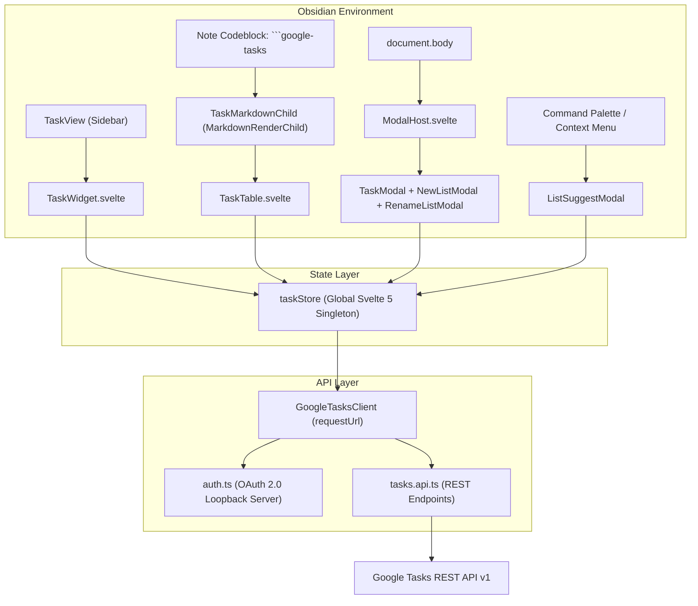

# AGENTS.md — Developer & AI Agent Architecture Guide

This document is the authoritative architectural and implementation guide for the `og-task-plugin` codebase. It is designed to give AI coding agents and human developers immediate, complete context on project architecture, code conventions, data flows, and constraints.

---

## 1. Project Overview & Tech Stack

`og-task-plugin` is an Obsidian community plugin that provides two-way cloud synchronization with the **Google Tasks REST API (v1)**.

- **Platform**: Obsidian Desktop & Mobile (minimum app version: `1.7.2`).
- **Language**: TypeScript (`"strict": true`).
- **UI Framework**: **Svelte 5** using native runes (`$state`, `$derived`, `$effect`, `$props`).
- **Components**: **Bits UI** (headless, accessible primitives for `DropdownMenu` and `Dialog`).
- **Styling**: Tailwind CSS v4 CLI (`src/app.css` → `styles.css`) + Obsidian CSS variables (`var(--background-primary)`, `var(--text-normal)`, etc.).
- **Bundler**: **esbuild** (`esbuild.config.mjs` with `esbuild-svelte`).
- **Linter**: ESLint with `eslint-plugin-obsidianmd`.

---

## 2. Directory Structure & Responsibilities

```text
og-task-plugin/
├── src/
│   ├── main.ts                 # Plugin lifecycle (onload, onunload), commands, codeblock registration
│   ├── view.ts                 # Obsidian ItemView wrapper mounting TaskWidget.svelte
│   ├── settings.ts             # Settings data model (OgTaskSettings, DEFAULT_SETTINGS)
│   ├── app.css                 # Tailwind v4 source + Obsidian codeblock border resets
│   │
│   ├── api/                    # HTTP Transport & Google Tasks API
│   │   ├── auth.ts             # OAuth 2.0 loopback server & token refresh (Platform.isDesktop guarded)
│   │   ├── client.ts           # GoogleTasksClient wrapping requestUrl with auto-refresh on 401
│   │   └── tasks.api.ts        # Typed API endpoints (tasklists, tasks, partial fields)
│   │
│   ├── store/                  # Global State Management
│   │   └── tasks.svelte.ts     # TaskStore: reactive Svelte 5 singleton for tasks, lists, modals, sorting
│   │
│   ├── ui/                     # Svelte 5 & Obsidian UI Components
│   │   ├── TaskWidget.svelte   # Sidebar view (mobile-widget style)
│   │   ├── TaskTable.svelte    # Embedded note view (desktop-app table style)
│   │   ├── TaskModal.svelte    # Create/Edit task modal (Bits UI Dialog)
│   │   ├── NewListModal.svelte # Create list modal (Bits UI Dialog)
│   │   ├── RenameListModal.svelte # Rename list modal (Bits UI Dialog)
│   │   ├── ModalHost.svelte    # Root modal container mounted to document.body
│   │   └── ListSuggestModal.ts # FuzzySuggestModal for picking a task list in notes
│   │
│   ├── markdown/               # Note Embedding
│   │   └── processor.ts        # TaskMarkdownChild (MarkdownRenderChild) for ```google-tasks blocks
│   │
│   └── utils/                  # Shared Helpers
│       ├── date.ts             # getDueInfo(): relative date calculations (Today, Yesterday, overdue)
│       ├── icons.ts            # Zero-dependency SVG icon library styled with currentColor
│       └── settingTab.ts       # Obsidian PluginSettingTab with OAuth login and token persistence
│
├── esbuild.config.mjs          # esbuild bundler configuration (Svelte 5 native TypeScript)
├── eslint.config.mts           # ESLint configuration with Svelte runes globals
├── manifest.json               # Plugin metadata (id, version, minAppVersion: 1.7.2)
├── package.json                # npm dependencies and scripts
└── styles.css                  # Production compiled CSS artifact
```

---

## 3. Architecture & Data Flow



### Global Store Singleton (`src/store/tasks.svelte.ts`)
- State is held in a single exported singleton: `export const taskStore = new TaskStore();`.
- Initialized in `main.ts` via `taskStore.init(this)`.
- **Optimistic Updates**: Task status toggling, updates, and deletions modify `$state` arrays immediately before issuing background HTTP requests to Google Tasks. If the request fails, state rolls back and displays an error via `new Notice()`.
- **Sorting**: Handled client-side via `$derived` getter `taskStore.sortedActiveTasks` (`myOrder`, `date`, `title`).

### Centralized Modal Architecture (`src/ui/ModalHost.svelte`)
- Modals (`TaskModal`, `NewListModal`, `RenameListModal`) are **not** mounted inside individual views.
- They are mounted **once** at the plugin level in `main.ts` into `document.body` via `ModalHost.svelte` and cleanly unregistered in `onunload()`.
- Any component triggers modals by calling `taskStore.openCreateModal()`, `taskStore.openEditModal(task)`, `taskStore.openNewListModal()`, or `taskStore.openRenameModal()`.

---

## 4. Key Domain Rules & API Constraints

### A. Google Tasks REST API v1
1. **No `orderBy` Parameter**: The API strictly returns tasks in their manual cloud sequence. **Sorting must be computed on the client side**.
2. **Date-Only Due Dates**: Google Tasks API normalizes timestamps to `T00:00:00.000Z` and strips time-of-day. In Google Calendar, tasks always render as **all-day items**. Do not add a time picker to task creation.
3. **No Starred/Favorite Field**: The v1 REST API does not expose task stars; starred tasks are consumer-app-only features and cannot be synced.
4. **Primary/Default List Protection**: The user's default list (`taskStore.isDefaultList`) cannot be deleted via the API; disable delete buttons for default lists.

### B. Obsidian Linter Rules (`eslint-plugin-obsidianmd`)
- **No Static Node.js Imports**: Never do `import * as http from 'http'`. Node.js built-ins must be dynamically imported and guarded:
  ```ts
  if (Platform.isDesktop) {
      const http = await import('http');
  }
  ```
- **Sentence Case UI Text**: All user-facing strings (setting names, notices, placeholders, commands) must use sentence case:
  - ✅ `'Google tasks'`, `'Client secret'`, `'Account status'`
  - ❌ `'Google Tasks'`, `'Client Secret'`, `'Account Status'`
- **Settings Tab**: `SettingTab` must implement `getSettingDefinitions(): unknown[] { return []; }` and use `this.display()` for re-rendering under `minAppVersion: "1.7.2"`.

### C. UI & Design Conventions
- **No Emojis**: Never use emojis for actions or indicators (no 📝, ✏️, 🗑️, 📅). Use the SVG icons exported from `src/utils/icons.ts` styled with `currentColor`.
- **CSS Variables**: Always use Obsidian's CSS custom properties (`var(--background-primary)`, `var(--text-normal)`, `var(--interactive-accent)`, `var(--text-error)`).
- **Codeblock Border Neutralization**: Obsidian wraps codeblocks in `.cm-embed-block` and `.block-language-*` with borders and padding. `src/app.css` explicitly resets these to `border: none !important; background: transparent !important; padding: 0 !important;` so embedded tables render cleanly without double borders.

---

## 5. Development & Testing Commands

```bash
# Install dependencies
npm install

# Development watch mode (esbuild watch)
npm run dev

# Full production build (tsc typecheck + esbuild bundle + tailwindcss)
npm run build

# Run Obsidian linter
npm run lint
```

When adding or modifying features, always ensure:
1. `npm run build` exits with code 0 and **0 warnings**.
2. `npm run lint` exits with code 0 and **0 warnings**.
